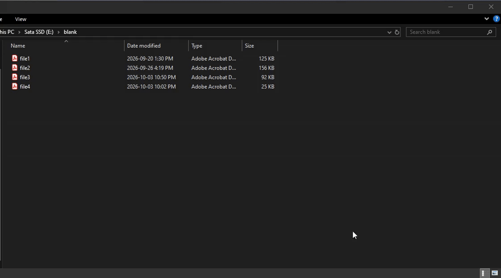

# PDF Toolkit for Windows

[](https://github.com/RohanPlimbachia/pdf-toolkit/actions/workflows/build.yml)
[](LICENSE)

Right-click tools for PDFs in File Explorer, like the built-in "Create PDF" Quick Action on macOS. Windows has no built-in way to combine PDFs, and most online tools make you upload your documents. This does it locally in one click.



**Current feature:** select several PDFs and/or images (JPG, PNG), right-click, choose **Merge into PDF**, and get a single `Merged.pdf` in the same folder.

- Files are combined in name order, the same way Explorer sorts them (`page 2` comes before `page 10`).
- Each image gets its own Letter-sized page, scaled to fit.
- Right-clicking a single image converts it to a PDF.
- Existing files are never overwritten (`Merged (2).pdf`, `Merged (3).pdf`, ...).
- Everything runs locally. No files are uploaded anywhere.

## Download and install

1. Download `pdf-toolkit-win-x64.zip` from the [latest release](https://github.com/RohanPlimbachia/pdf-toolkit/releases/latest) and unzip it anywhere you'll keep it.
2. In the unzipped folder, run:

   ```powershell
   powershell -ExecutionPolicy Bypass -File scripts\install-context-menu.ps1
   ```

That's it: no admin rights and no .NET install needed. Works on Windows 10 and 11.

## Build from source

Needs the [.NET 8 SDK](https://dotnet.microsoft.com/download/dotnet/8.0).

```powershell
# 1. Build a release copy into the publish\ folder
dotnet publish src\PdfMerge -c Release -r win-x64 --self-contained false -o publish

# 2. Add "Merge into PDF" to the right-click menu (current user only, no admin needed)
powershell -ExecutionPolicy Bypass -File scripts\install-context-menu.ps1
```

To remove it from the menu:

```powershell
powershell -ExecutionPolicy Bypass -File scripts\uninstall-context-menu.ps1
```

## How it works

Explorer starts **one copy of the program per selected file**. The first copy grabs a named mutex and listens on a named pipe; every later copy sends its file path to the first one and exits. Once no new paths arrive for 0.8 s, the first copy merges everything. See `src/PdfMerge/SingleInstance.cs`.

| File | Purpose |
|---|---|
| `src/PdfMerge/Program.cs` | Entry point: collects files, sorts them, runs the merge |
| `src/PdfMerge/SingleInstance.cs` | Gathers paths from all the copies Explorer launches |
| `src/PdfMerge/Merger.cs` | PDF and image merging (uses [PDFsharp](https://github.com/empira/PDFsharp), MIT) |
| `src/PdfMerge/Native.cs` | Windows message boxes and Explorer-style sorting |
| `scripts/*.ps1` | Add or remove the right-click menu entry |

## Design decisions

- **Registry entries under `HKEY_CURRENT_USER`**, so installing never needs admin rights and uninstalling leaves nothing behind.
- **`MultiSelectModel = Player`** in the registry lifts Explorer's default limit of 15 files for a multi-select menu item.
- **A short "quiet period" instead of a fixed file count.** Explorer doesn't tell the program how many files were selected, so the collector waits until no new path arrives for 0.8 s.
- **Never overwrite.** Output goes to the next free name, so a merge can't destroy an earlier one.
- **Clear errors.** Password-protected or damaged PDFs produce a message naming the file instead of a crash.

## Roadmap

- [ ] Split a PDF into single pages
- [ ] Rotate pages
- [ ] Extract a page range
- [ ] A small window to reorder files before merging
- [ ] Show up in the Windows 11 compact right-click menu (needs a packaged app)
- [ ] Installer (MSIX or Inno Setup)
